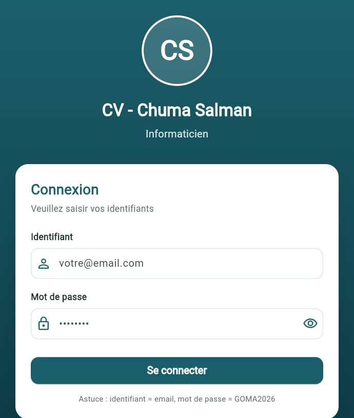
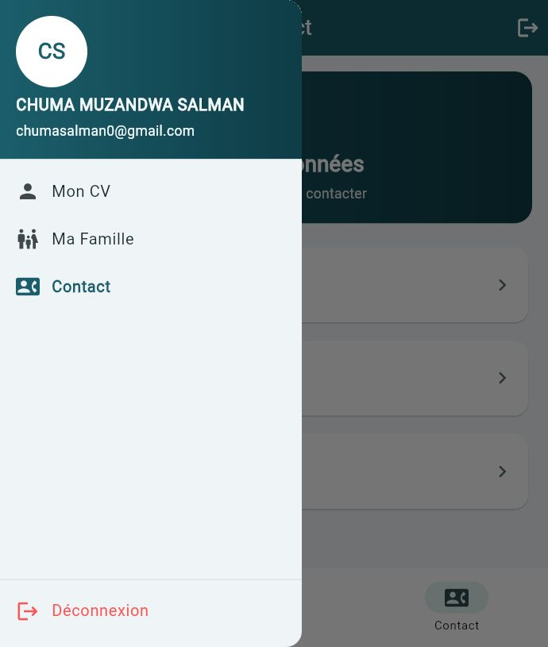

# CV Flutter — Chuma Muzandwa Salman

Application mobile Flutter présentant mon CV, ma famille et mes coordonnées.
L'accès à l'application se fait via une page de connexion.

## 📋 Fonctionnalités

- 🔐 **Page de connexion** avec identifiant et mot de passe
- 📄 **Page CV** : photo, nom, titre, formation, expériences, compétences, langues
- 👨‍👩‍👧‍👦 **Page Famille** : membres de la famille (nom, photo, lien de parenté, profession)
- 📞 **Page Contact** : téléphone, e-mail, adresse et réseaux sociaux (cliquables)
- 🧭 **Navigation** via Drawer (menu latéral) + BottomNavigationBar ( barre du bas)
- 🎨 Interface professionnelle avec thème teal

## 🔑 Identifiants de connexion

| Champ | Valeur |
|-------|--------|
| Identifiant | `chumasalman0@gmail.com` |
| Mot de passe | `GOMA2026` |

## 📸 Captures d'écran

### 1. Page de connexion


### 2. Page CV (Accueil)


### 3. Page Famille


### 4. Page Contact


### 5. Menu latéral (Drawer)


## 🚀 Installation et exécution

### Prérequis
- Flutter SDK (3.x ou supérieur)
- Android Studio / VS Code
- Un émulateur Android ou un appareil physique

### Étapes

```bash
# Cloner le dépôt
git clone https://github.com/chumasalman/cv_flutter_salman.git
cd cv_flutter_salman

# Installer les dépendances
flutter pub get

# Lancer l'application
flutter run
```

### Générer l'APK

```bash
flutter build apk --release
```

L'APK se trouvera dans `build/app/outputs/flutter-apk/app-release.apk`.

## 🛠 Stack technique

- **Framework** : Flutter
- **Langage** : Dart
- **Dépendances** :
  - `url_launcher` — pour lancer les appels, e-mails et liens web
  - `cupertino_icons` — icônes iOS

## 📁 Structure du projet

```
lib/
├── main.dart              # Point d'entrée, thème de l'application
├── constants.dart         # Données du CV, couleurs, identifiants
└── screens/
    ├── login_page.dart    # Page de connexion
    ├── main_shell.dart    # Squelette avec Drawer + BottomNavigationBar
    ├── cv_page.dart       # Page CV
    ├── family_page.dart   # Page Famille
    └── contact_page.dart  # Page Contact
```

## 👤 Auteur

**Chuma Muzandwa Salman** — Informaticien
- 📧 chumasalman0@gmail.com
- 📍 Goma, Nord-Kivu, RDC
