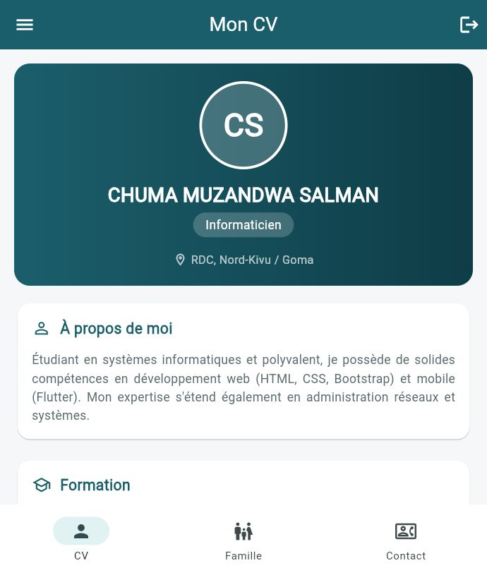
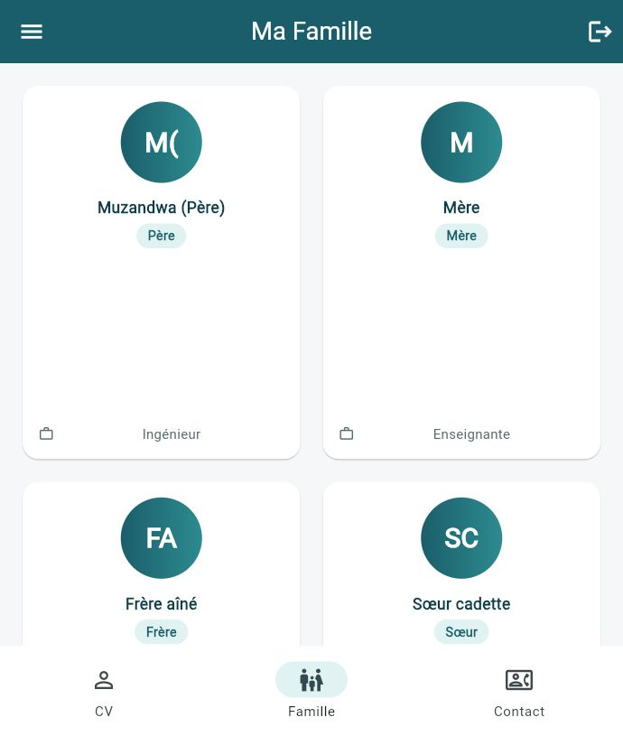
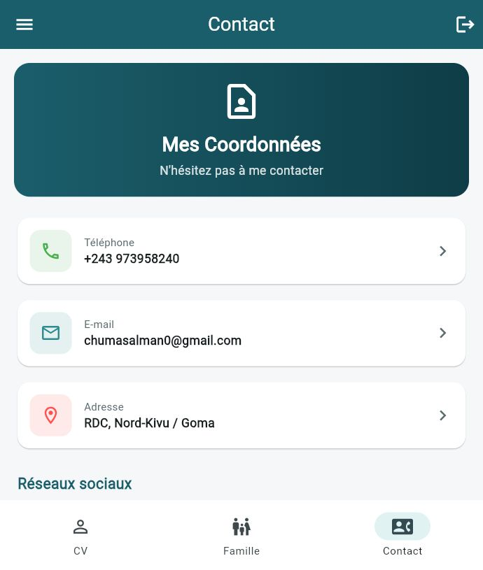

# CV Flutter – TP2

Application mobile réalisée avec Flutter dans le cadre du **TP2 du cours de Langage de Programmation Mobile**, à l’ISIG GOMA, Licence 3.

Elle reprend l’application CV du TP1 et ajoute une authentification réelle ainsi qu’une gestion dynamique des membres de famille via une API PHP/MySQL.

## Présentation

L’application contient les fonctionnalités suivantes :

- **Connexion :** vérification de l’adresse e-mail et du mot de passe auprès de l’API PHP.
- **Mon CV :** profil, formation, expériences, compétences et coordonnées.
- **Ma Famille :** chargement des membres depuis MySQL, ajout, modification et suppression.
- **Contact :** téléphone, e-mail, localisation et réseaux sociaux.
- **Navigation :** barre inférieure, menu latéral et déconnexion.

## Architecture

```text
cv_flutter_salman/
├── lib/
│   ├── main.dart
│   ├── constants.dart
│   ├── screens/
│   │   ├── login_page.dart
│   │   ├── main_shell.dart
│   │   ├── cv_page.dart
│   │   ├── family_page.dart
│   │   └── contact_page.dart
│   └── services/
│       └── api_service.dart
├── test/
│   └── widget_test.dart
├── assets/images/
├── android/
└── pubspec.yaml
```

- `MonCvApp` configure le thème et démarre l’application sur `LoginPage`.
- `LoginPage` appelle `ApiService.seConnecter()` avant d’ouvrir `MainShell`.
- `ApiService` centralise les requêtes HTTP, les en-têtes JSON, les délais d’attente et la vérification des codes HTTP et du champ `success`.
- `FamilyPage` utilise un `FutureBuilder` pour afficher le chargement, les erreurs et les données renvoyées par l’API.
- Les formulaires envoient les dates au format `AAAA-MM-JJ` et rechargent la liste après chaque opération.

### API PHP utilisée

L’application communique avec l’API de référence [`api-test`](https://github.com/espoirbaraka/api-test), installée localement dans `C:\xampp\htdocs\api-test`.

| Fonction | Méthode | Route |
|---|---|---|
| Tester le serveur | `GET` | `/famille-membres` |
| Se connecter | `POST` | `/accounts/login` |
| Créer un compte | `POST` | `/accounts/register` |
| Lister les membres | `GET` | `/famille-membres` |
| Ajouter un membre | `POST` | `/famille-membres` |
| Modifier un membre | `PUT` | `/famille-membres/{id}` |
| Supprimer un membre | `DELETE` | `/famille-membres/{id}` |

## Prérequis

- Flutter SDK 3.44 ou une version compatible avec Dart 3.12.
- XAMPP avec Apache et MySQL.
- PHP 8.2 ou une version plus récente.
- Un navigateur web, un émulateur Android ou un téléphone physique.

## Installation de l’API

1. Placer le dossier `api-test` dans `C:\xampp\htdocs`.
2. Démarrer **Apache** sur le port `8080` et **MySQL** dans XAMPP.
3. Créer une base de données nommée `api` dans phpMyAdmin.
4. Importer le fichier `api.sql`.
5. Configurer le fichier `.env` :

   ```env
   DB_HOST=127.0.0.1
   DB_PORT=3306
   DB_DATABASE=api
   DB_USERNAME=root
   DB_PASSWORD=
   ```

6. Vérifier l’API à l’adresse suivante :

   ```text
   http://localhost:8080/api-test/public/famille-membres
   ```

7. Créer un compte de démonstration avec `POST /accounts/register` en envoyant un JSON contenant `email` et `password`.

## Installation de l’application Flutter

Cloner le dépôt :

```bash
git clone https://github.com/Ir-Justin-KK/cv_flutter_justin.git
```

Entrer dans le dossier du projet :

```bash
cd cv_flutter_justin
```

Installer les dépendances :

```bash
flutter pub get
```

## Configuration de l’adresse de l’API

La base URL est définie dans `lib/services/api_service.dart` :

```dart
static const String baseUrl = 'http://localhost:8080/api-test/public';
```

Selon la plateforme utilisée :

| Plateforme | Adresse à utiliser |
|---|---|
| Navigateur web ou bureau Windows | `http://localhost:8080/api-test/public` |
| Apache sur le port 80 | `http://localhost/api-test/public` |
| Émulateur Android | `http://10.0.2.2:8080/api-test/public` |
| Téléphone physique | `http://ADRESSE_IP_LOCALE:8080/api-test/public` |

Pour un téléphone physique, l’ordinateur et le téléphone doivent être sur le même réseau. Il peut également être nécessaire d’autoriser le port `8080` dans le pare-feu Windows.

La permission Android `INTERNET` est déjà déclarée dans le manifest principal. Le trafic HTTP en clair est autorisé uniquement pour permettre la communication avec l’API locale pendant le développement ; une mise en production devra utiliser HTTPS.

## Lancement

Application web :

```bash
flutter run -d chrome
```

Application Windows :

```bash
flutter run -d windows
```

Application Android :

```bash
flutter run
```

## Vérifications

```bash
dart format lib test
flutter analyze
flutter test
```

## Captures d’écran

### Page de connexion


### Mon CV



### Ma Famille



### Contact



### Menu latéral


## Démonstration vidéo

[Regarder la démonstration de mon application Flutter](./video.mp4)

Déposer le fichier `video.mp4` à la racine du dépôt pour activer ce lien.

## Dépôt GitHub

[https://github.com/Ir-Justin-KK/cv_flutter_justin](https://github.com/Ir-Justin-KK/cv_flutter_justin)

---

**Réalisé par Chuma Muzandwa Salman — ISIG GOMA, Licence 3 — Année académique 2026**
